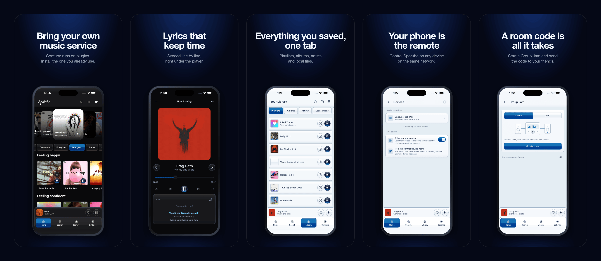

<div align="center">
  

A cross-platform extensible open-source music streaming platform.<br>
Bring your own music metadata/playlist/audio-source with plugins created by community or by
yourself. A small step towards the decentralized music streaming era!

<a href="https://spotube.cc"></a>
<a href="https://discord.gg/uJ94vxB6vg"></a>

<a href="https://patreon.com/krtirtho"></a>
<a href="https://www.buymeacoffee.com/krtirtho"></a>

[](https://news.ycombinator.com/item?id=39066136)

<a href="https://opencollective.com/spotube"></a>

---




****</div>

## 🌃 Features

- 🧩 Plugin powered, supports any platform or custom music service through plugins.
- 🗺️ Community driven plugins for popular platforms or create your own.
- ⬇️ Freely downloadable tracks with tagged **metadata**.
- 🖥️ 📱 Cross-platform support.
- 🪶 Small size & less data usage.
- 🕒 Time synced lyrics regardless of the plugin support.
- ✋ No telemetry, diagnostics or user data collection.
- 🚀 Native performance.
- 📖 Open source/libre software.
- 🔉 Playback control is done locally, not on the server.

### ⬇️ Download

Download Spotube from the Official Website: https://spotube.cc

### 🔄 Nightly Builds

Grab the latest nightly builds of
Spotube [from the Offical Website](https://spotube.cc/downloads/nightly).

<details>
<summary>
<h3 style="display: inline;">🕳️ Building from source [Click to expand]</h3>
</summary>
<hr/>
<a href="https://github.com/team-spotube/spotube/actions"></a>

Spotube is a Compose Multiplatform app.

### 1. Prerequisites

- **JDK 21** to run Gradle (the Gradle daemon JDK and GraalVM are provisioned automatically).
- **Rust** (`rustup` + `cargo`), for the `composeApp` library built
  through [Gobley](https://gobley.dev).
- **Android SDK**, only for Android builds.
- **[ComposeNativeWebview](https://github.com/kdroidFilter/ComposeNativeWebview)**, which isn't on
  Maven Central yet. Clone it at the commit pinned as `COMPOSE_WEBVIEW_COMMIT` in [
  `spotube-release-binary.yml`](.github/workflows/spotube-release-binary.yml) and run
  `./gradlew publishToMavenLocal` in it.
- **Linux only: runtime libraries, including VLC.** Needed to run the app, including
  `:composeApp:run`:

  | Distro                   | Command                                                                                                                                                          |
  | ------------------------ | ---------------------------------------------------------------------------------------------------------------------------------------------------------------- |
  | Debian/Ubuntu            | `sudo apt-get install libvlc5 vlc-plugin-base libwebkit2gtk-4.1-0 libgtk-3-0 libasound2 libgl1 libxtst6 libxi6 libxrender1`                                      |
  | Fedora                   | `sudo dnf install vlc-libs webkit2gtk4.1 gtk3 alsa-lib mesa-libGL libXtst libXi libXrender` (`vlc-libs` needs [RPM Fusion](https://rpmfusion.org/Configuration)) |
  | Arch / CachyOS / Manjaro | `sudo pacman -S vlc webkit2gtk-4.1 gtk3 alsa-lib libglvnd libxtst libxi libxrender`                                                                              |
  | openSUSE                 | `sudo zypper install libvlc5 libwebkit2gtk-4_1-0 libgtk-3-0 libasound2 Mesa-libGL1 libXtst6 libXi6 libXrender1`                                                  |

  On Ubuntu 24.04+/Debian 13, `libgtk-3-0` and `libasound2` are `libgtk-3-0t64` and `libasound2t64`;
  apt resolves this itself.

### 2. Run in development

Desktop (JVM), fastest edit/run loop
```bash
./gradlew :composeApp:run
```

Android debug APK
```bash
./gradlew :composeApp:assembleStableDebug
```
> Use `./gradlew :composeApp:assembleNightlyDebug` for the nightly channel.

Development builds stay fast: the release-only optimizations below are skipped.

### 3. Build the desktop app

A native build takes **about 10 minutes**, uses **every CPU core** and peaks at **~15 GB of RAM**.
It only happens for the tasks below, never for `run`.

**Native toolchain** (Nucleus downloads GraalVM CE on the first build; set `GRAALVM_HOME` to use
your own):

| OS      | Requirements                                                                                                                                                                                                                                                    |
| ------- | --------------------------------------------------------------------------------------------------------------------------------------------------------------------------------------------------------------------------------------------------------------- |
| Linux   | `gcc`, `zlib` headers, `patchelf`; `rpm` for `.rpm`, `fuse` + `zstd` for `.AppImage`. <br/>Debian/Ubuntu: `sudo apt-get install build-essential zlib1g-dev patchelf rpm fuse zstd`. <br/>Fedora: `sudo dnf install gcc zlib-devel patchelf rpm-build fuse zstd` |
| macOS   | Xcode Command Line Tools (`xcode-select --install`)                                                                                                                                                                                                             |
| Windows | Visual Studio Build Tools with "Desktop development with C++" (use an "x64 Native Tools" prompt if `native-image` can't find MSVC)                                                                                                                              |

**Build and run the app folder:**

```bash
./gradlew :composeApp:createGraalvmNativeDistributable
```
> Output folder: composeApp/build/compose/binaries/main/graalvm-app/

Build and launch in one step
```bash
./gradlew :composeApp:runGraalvmNativeDistributable
```

Keep the `spotube` binary next to the libraries it was built with; it loads them from its own
folder.

**Installers** (each OS builds only its own):

| OS               | Command                                                                 |
| ---------------- | ----------------------------------------------------------------------- |
| Linux            | `./gradlew :composeApp:packageGraalvmDeb :composeApp:packageGraalvmRpm` |
| Linux (AppImage) | `./gradlew :composeApp:packageGraalvmAppImage -PappImage=true`          |
| Windows          | `./gradlew :composeApp:packageGraalvmExe` (or `packageGraalvmMsi`)      |
| macOS            | `./gradlew :composeApp:packageGraalvmDmg`                               |
> Output folder: `composeApp/build/compose/binaries/main/graalvm-<format>`

> [!Tip]
> Add `-Pnightly=true` for the nightly channel (separate icons and name).

<details>
<summary>How the Linux AppImage bundle works</summary>

- [`DownloadLinuxGtkBundleTask`](buildSrc/src/main/kotlin/org/spotube/gradle/DownloadLinuxGtkBundleTask.kt)
  downloads the Ubuntu 24.04 packages (audio-only VLC via
  [vlcj-bundler](https://github.com/team-spotube/vlcj-bundler-gradle-plugin), GTK 3, WebKitGTK 4.1,
  glib-networking), keeps only what GTK/WebKit reach and relocates the libraries with `patchelf`.
  Needs `ar`, `tar`, `zstd`, `readelf`, `patchelf`.
- WebKitGTK has its helper-process path compiled in, so
  [`AppImageEnvironment`](composeApp/src/jvmMain/kotlin/org/spotube/spotube/core/appimage/AppImageEnvironment.kt)
  patches it to a relative path and moves to that directory at startup. It also sets
  `GIO_EXTRA_MODULES` and `WEBKIT_DISABLE_DMABUF_RENDERER=1` (the bundled WebKitGTK 2.44 never
  paints against a newer host Mesa).
- `main()` must call `GraalVmInitializer.initialize()` first: the VLC loader and the environment
  setup read `compose.application.resources.dir`.

</details>

### 4. Native build breaks, JVM works

A native image is a closed world: everything reached through reflection, JNI or JNA (vlcj, Zipline,
NewPipe, ktor, datastore, ...) must be declared at build time. Nucleus generates most of it; the
rest lives in [`composeApp/graalvm/reachability-metadata.json`](composeApp/graalvm/reachability-metadata.json).

Symptoms: `ClassNotFoundException`, `NoSuchMethodException` or `MissingReflectionRegistrationError`
in the native binary, while `:composeApp:run` works.

1. `./gradlew :composeApp:runWithNativeAgent` starts the app on the JVM with GraalVM's tracing agent.
2. Use the broken feature, then **close the window normally**. Ctrl+C discards the recording.
3. Commit the updated JSON in `composeApp/graalvm/` and rebuild.

> [!Tip]
> `./gradlew :composeApp:runGraalvmNative` is a faster debug loop: a quick `-Ob` build that names the
> missing registration.

> [!Warning]
> Keep the hand-written `uk.co.caprica.vlcj.binding.lib.LibVlc` entry, or playback fails to initialize.

### 5. Production vs development builds

Production mode turns on automatically for `package*`, `create*`, `notarize*` and
`nativeImageCompile` tasks. Force it with `-Pproduction=true|false`.

| Area        | Development            | Production                                                                                                               |
| ----------- | ---------------------- | ------------------------------------------------------------------------------------------------------------------------ |
| Rust lib    | fast `debug` profile   | `release` with LTO and stripping (31 MB → 1.8 MB)                                                                        |
| Desktop app | hot-reloadable JVM app | size-optimized (`-Os`) GraalVM native image                                                                              |
| Native libs | all                    | host OS/CPU only; Skia loaded from `lib/`; on Linux ~10 KB `libjvm.so`/`libjava.so` shims instead of the JDK's 28 MB one |

Android picks the Rust profile from its build type.

### 6. Releases

Run [`spotube-release-binary.yml`](.github/workflows/spotube-release-binary.yml) manually
(`workflow_dispatch`) as `stable`, `beta` or `nightly`.

- **Beta:** the stable build as a draft, tagged `v<version>-beta.N`. Set `betaNumber` in
  `composeApp/build.gradle.kts` to N, and back to `null` for stable.
- **Desktop:** each platform (Linux x86_64 and aarch64, Windows, macOS) builds its installers on its
  own runner.
- **Android:** a signed APK.

</details>
<hr/>

## 📚 Resources

**Core stack**
- [Kotlin Multiplatform](https://kotlinlang.org/docs/multiplatform.html)
- [Compose Multiplatform](https://www.jetbrains.com/compose-multiplatform/)
- [Compose Hot Reload](https://github.com/JetBrains/compose-hot-reload)
- [Koin for KMP](https://insert-koin.io/docs/reference/koin-mp/kmp)
- [Ktor client](https://ktor.io/docs/client-create-multiplatform-application.html)
- [DataStore for KMP](https://developer.android.com/kotlin/multiplatform/datastore)

**Desktop and native**
- [Nucleus](https://github.com/kdroidFilter/Nucleus): desktop packaging and GraalVM integration
- [ComposeNativeWebview](https://github.com/kdroidFilter/ComposeNativeWebview)
- [GraalVM Native Image](https://www.graalvm.org/latest/reference-manual/native-image/) and its
  [reachability metadata](https://www.graalvm.org/latest/reference-manual/native-image/metadata/)
- [Gobley](https://gobley.dev): Rust in Kotlin Multiplatform
- [vlcj](https://github.com/caprica/vlcj): VLC bindings for audio playback

**Plugins**
- [Zipline](https://github.com/cashapp/zipline): runs the JS plugins

## 👥 The Spotube team

- [Kingkor Roy Tirtho](https://github.com/team-spotube) - The Founder, Maintainer and Lead Developer
- [Owen Connor](https://github.com/owencz1998) - The Cool Discord Moderator
- [Piotr Rogowski](https://github.com/karniv00l) - The MacOS Developer
- [Rusty Apple](https://github.com/RustyApple) - The Mysterious Unknown Guy

## 💼 License

Spotube is open source and licensed under the [AGPL-3.0-or-later](/LICENSE) License.

<div align="center"><h4>© Copyright Spotube 2026</h4></div>
